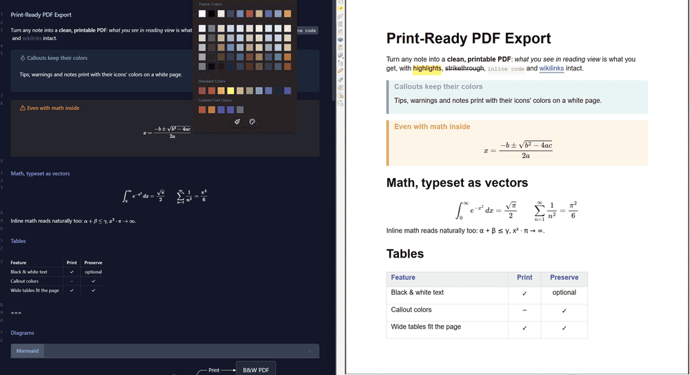

# Print-Ready PDF Export

Export an Obsidian note to PDF with [pdfmake](https://github.com/bpampuch/pdfmake). Two modes, explicit page breaks, and full layout control.



See the source and output: [example.md](docs/example.md) and [example.pdf](docs/example.pdf).

**Desktop only** (Windows, macOS and Linux) for now. Mobile support may come later.

## Features

- **Print optimized** mode: clean, print-friendly output. All text, callouts, links and code are black and white by default; turn on "Print text in color" in settings to print colors as displayed. Images are never converted.
- **Preserve formatting** mode: keeps Obsidian's styling (heading sizes, callout colors, highlights, code blocks) on a white page with dark text. An optional setting (off by default) renders a dark page instead.
- Embeds vault and remote images from `![[image.png]]`, `![[image.png|300]]` and ``.
- Page breaks: put `===` alone on a line, or use a `> [!page-break]` callout, to force a new page (configurable).
- Page size (Letter, A4, Legal, Tabloid, A3, A5), orientation, margins, font size and page-number style (1, 1 of 10, 1 / 10, Page 1, Page 1 of 10, – 1 –; left, center or right) are set in the plugin's settings.
- Math: `$$…$$` display math is typeset and embedded as vector graphics; inline `$…$` math is converted to plain text where possible (see Limitations).
- Code blocks: "Shrink code blocks to fit" (on by default) reduces the font size so the longest line fits without wrapping, down to "Minimum code font size" (6 pt by default); longer lines wrap below that. "Show code block language" (off by default) adds a header bar across the top of each fenced code block that has a language, showing the language name.
- Exports never overwrite: if the file exists, a number is appended (`note-print (1).pdf`).

## Usage

- Command palette: **Export to PDF (default mode)**, **Export to PDF (print optimized)** or **Export to PDF (preserve formatting)** (Obsidian shows them prefixed with the plugin name).
- File menu (the note's "More options" menu) and the file explorer's right-click menu: the same exports, prefixed "Print-Ready PDF:".

The PDF is saved into your vault, in the output folder if you set one, otherwise next to the exported note.

## What is exported

The note is rendered with Obsidian's own reading-view renderer and the result is converted to PDF, so the output follows what you see in Reading view rather than the raw markup: inline HTML (`<b>`, `<span style="color:...">`, `<u>`, `<sub>`, `<details>`, raw HTML tables, alignment), callouts of every type (theme colours, inline-formatted titles, long callouts split across pages), embedded notes, footnotes, task lists, tables (alignment, spans, formatted cells), images at their specified size (`|300`, `|300x200`, `width`/`height` attributes), SVG/GIF/WebP images, Mermaid diagrams, `%%comments%%` and HTML comments (hidden), and front matter (omitted). The note is read from the editor, so unsaved edits are included.

## Limitations

- The built-in fonts (Helvetica and Courier) cover Western European text (Windows-1252). Other scripts, arrows, symbols and emoji need a fallback font you add yourself; see "Non-Latin characters and symbols" below. Without one they are replaced with `?`. Fallback fonts have a single weight, so bold or italic text in those scripts prints in regular weight.
- An image in the middle of a line of text is placed on its own line, between the text before and after it.
- Math: display math (`$$…$$`) is typeset with a bundled MathJax and embedded as vector graphics. Inline math (`$…$`) cannot sit inside a line of text as a picture (pdfmake has no inline images), so simple formulas (Greek letters, operators, relations, arrows, sub/superscripts such as `x^2` or `\alpha + \beta`) are shown as plain text and anything that needs typesetting (fractions, roots, matrices, limits) as its TeX source in monospace. Greek letters and common math symbols print out of the box using a small built-in font subset (DejaVu Sans); a fallback font you configure takes priority, and anything neither covers falls back to an ASCII stand-in or `?`. MathJax is bundled, which makes `main.js` about 1.7 MB larger. If a formula cannot be matched to its source or fails to typeset, its TeX is shown instead. PDF, audio and video embeds become a placeholder line. Interactive plugin output is exported as Reading view shows it once it has finished rendering.
- Preserve mode does not follow your Obsidian theme: page, text and code colors are fixed, and only callout colors come from the theme.
- Desktop only: the plugin is marked desktop-only (Windows, macOS, Linux); it is not available on iOS or Android. Images are downscaled to at most 1800 px on the longest edge (JPEGs stay JPEG). PDF layout runs on the main thread, so very long notes make Obsidian pause for a few seconds while "Building PDF…" shows.

## Non-Latin characters and symbols

The built-in PDF fonts cover Western European text only. To export CJK, Cyrillic, Greek, arrows, symbols or emoji, add one or more font files under Settings → Print-Ready PDF → Fallback fonts (vault path, or an absolute path on desktop; `.ttf`, `.otf`, `.ttc`, `.woff`, `.woff2`). Each character uses the first listed font that contains it. Fonts you add are loaded only when a note needs them and are not bundled; the plugin itself includes only a small DejaVu Sans symbol subset (Greek letters and common math symbols), and your fallback fonts take priority over it. Emoji render as monochrome glyphs. CJK fonts are large, so a regional subset font keeps exports fast. Characters no font covers are replaced with `?` and a notice is shown.

## Installation

Until it appears in the community plugin list, install manually (desktop only): copy `main.js`, `manifest.json` and `styles.css` from the latest release into `<vault>/.obsidian/plugins/print-ready-pdf/`, then enable the plugin.

## Development

```
npm ci
npm run build
```

## License

MIT. See [THIRD-PARTY-NOTICES.md](THIRD-PARTY-NOTICES.md) for bundled libraries.
