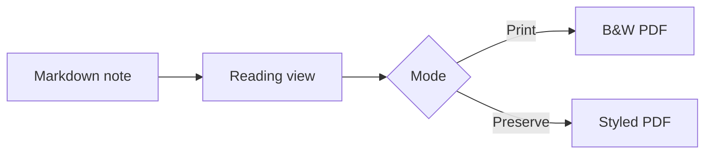
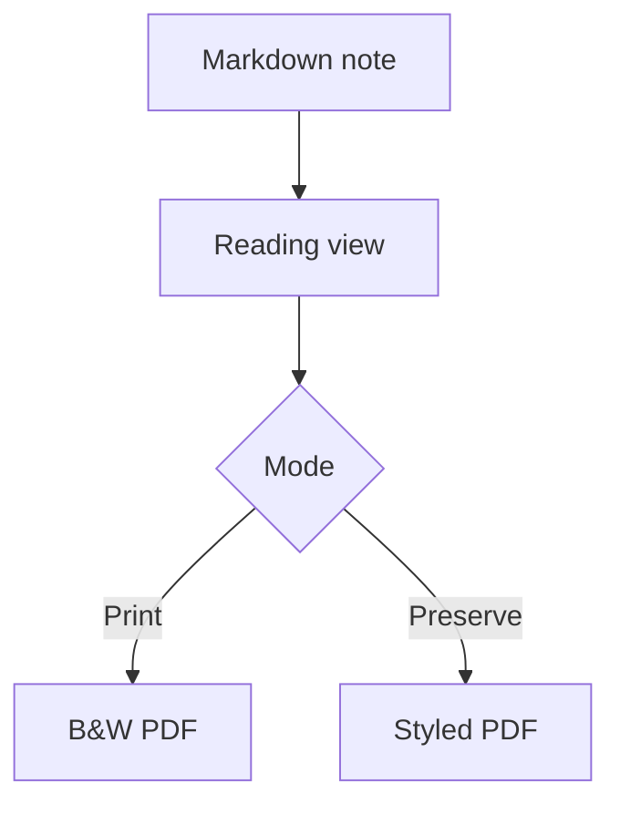

# Print-Ready PDF Export

Turn any note into a **clean, printable PDF**: *what you see in reading view* is what you get, with ==highlights==, ~~strikethrough~~, `inline code` and [[wikilinks]] intact.

> [!tip] Callouts keep their colors
> Tips, warnings and notes print with their icons' colors on a white page.

> [!warning] Even with math inside
> $$x = \frac{-b \pm \sqrt{b^2-4ac}}{2a}$$

## Math, typeset as vectors

$$
\int_0^\infty e^{-x^2}\,dx = \frac{\sqrt{\pi}}{2}
\qquad
\sum_{n=1}^{\infty} \frac{1}{n^2} = \frac{\pi^2}{6}
$$

Inline math reads naturally too: $\alpha + \beta \leq \gamma$, $x^2 \cdot \pi \to \infty$.

## Tables

| Feature                  | Print | Preserve |
| ------------------------ | :---: | :------: |
| Black & white text       |   ✓   | optional |
| Callout colors           |   –   |    ✓     |
| Wide tables fit the page |   ✓   |    ✓     |

===

## Diagrams





===
## Images

Full-page width (no width set)


Width set manually


===
## Code with language labels

```python
def fib(n: int) -> int:
    a, b = 0, 1
    for _ in range(n):
        a, b = b, a + b
    return a
```

## Tasks and lists

- [x] Unicode and Greek: café, naïve, Ω, λ, →
- [x] Footnotes[^1] and page numbers
- [ ] Your next export

> [!page-break]

## Page breaks on demand

The `===` or `> [!page-break]` line starts a fresh page.


[^1]: Footnotes are collected at the end of the document.